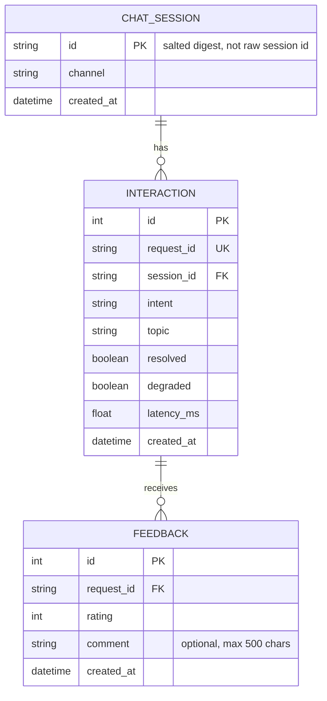

# Lab 5 - Data model and privacy review

This review uses the Lab 5 tutorial and starter schema. It follows the repository team plan's location, `docs/lab5/data_model.md`. The tutorial also names `lab05/worksheets/data_model.md` for H3; confirm the submission path with the team lead before delivery.

## 1. Critique of `sql/bad_schema.sql`

| # | Problem | Why it hurts | Fix |
|---:|---|---|---|
| 1 | `id` is not declared as a primary key or unique value. | A row cannot be identified or referenced reliably; duplicate IDs are allowed. | Give each interaction a database-generated primary key and give the API request ID a unique constraint. |
| 2 | Student names and phone numbers are stored with chat records. | The assistant's analytics do not need these identifiers; keeping them increases exposure if the database is disclosed. | Do not collect or persist names or phone numbers for these features. |
| 3 | Full messages and answers are stored indefinitely. | A question can include personal details, and no listed analytics feature needs the conversation text. | Store only structured interaction metadata; do not save raw question or answer text. |
| 4 | Ratings are packed into one comma-separated `feedback` value. | Individual ratings cannot be validated, indexed, linked to a specific answer, or counted reliably. | Store each rating as its own feedback row with a foreign key to the interaction and a constrained rating value. |
| 5 | `intent` is unconstrained free text. | Equivalent intents can be recorded as `fee`, `Fee`, or `tuition`, splitting counts and making queries unreliable. | Use a controlled intent vocabulary (and validate it at the API/database boundary). |
| 6 | `time` and `latency` are text. | Text values are difficult to sort and aggregate consistently; `120ms` is not a numeric duration. | Store timestamps in a consistent datetime representation and latency as a numeric millisecond value. |

The replacement design separates `chat_session`, `interaction`, and `feedback`, with primary/foreign keys and one feedback row per submitted rating. The current `Feedback` model permits multiple rows for one request ID; if the product allows only one rating per answer, add a uniqueness constraint and define duplicate-submission behavior.

## 2. Store or not?

| Data | Store? | Form | Retention | Reason |
|---|---|---|---|---|
| Raw user message | No | None | None | It may contain personal details and is not needed for the listed analytics. |
| Session ID | Yes | Salted SHA-256 digest; current code stores the first 16 hex characters | No period is specified in the starter; agree a retention period and purge process | Supports session counts without storing the raw session identifier. The stable digest remains linkable across interactions, so treat it as pseudonymous data. |
| Intent, latency, topic, resolved/degraded flags | Yes | Structured fields (`intent`, `topic`, booleans, numeric milliseconds) | No period is specified; retain only as long as the analytics need them | Supports counts, response-time analysis, and finding unresolved topics without retaining message text. |
| Feedback rating | Yes | Integer rating (`-1`, `0`, or `1`) linked to the real request ID | No period is specified; align with the interaction retention policy | Enables feedback reporting for a real response. Validate the allowed values. |
| Optional feedback comment | Only if the feedback feature needs it | User-submitted text, capped at 500 characters by the current model | Define a short, explicit retention period; the starter does not define one | Comments can contain personal details. Restrict access, do not use them as chat history, and provide a way to remove them. If the team requires zero raw text in the database, disable comment storage. |
| Student name / phone | No | None | None | Not needed to answer the assistant's product questions. |
| Hashing salt | No, never in the database or Git | Environment/secret configuration only | Rotate if exposed; do not log | It is needed to compute the session digest but is itself a secret. |

The implementation currently computes `SHA-256(salt + raw_session_id)` and truncates the hexadecimal digest to 16 characters. Keep the raw ID and salt out of rows, logs, and committed files. The course tutorial specifies salted SHA-256; this review does not describe it as HMAC.

## 3. Product questions and fields

| Product question | Fields needed | Table(s) | Query sketch |
|---|---|---|---|
| Which intent fails most often? | `intent`, `resolved` | `interaction` | `SELECT intent, COUNT(*) AS failures FROM interaction WHERE resolved = 0 GROUP BY intent ORDER BY failures DESC;` |
| What is the average response time by intent? | `intent`, `latency_ms` | `interaction` | `SELECT intent, ROUND(AVG(latency_ms), 1) AS avg_latency_ms FROM interaction GROUP BY intent;` |
| Which topics are most often unresolved? | `topic`, `resolved` | `interaction` | `SELECT topic, COUNT(*) AS failures FROM interaction WHERE resolved = 0 AND topic IS NOT NULL GROUP BY topic ORDER BY failures DESC;` |

## 4. ER diagram

No message or answer text is persisted in this model. Optional feedback comments are a separate, user-submitted field and need their own access and retention rules.